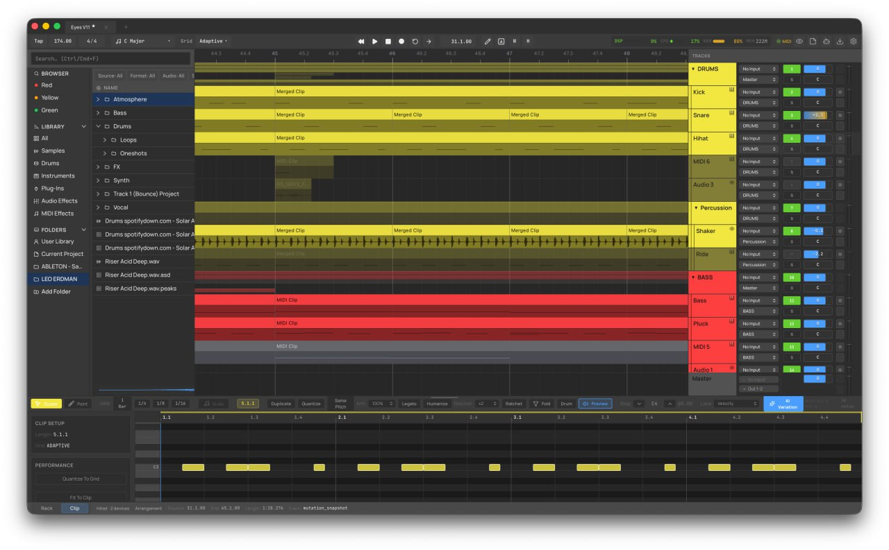
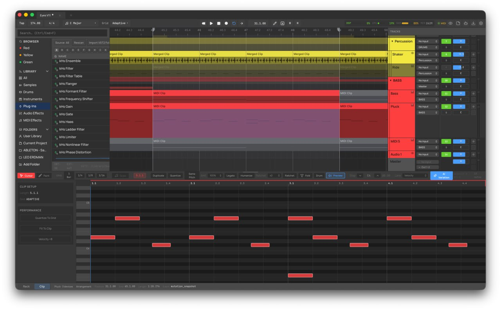
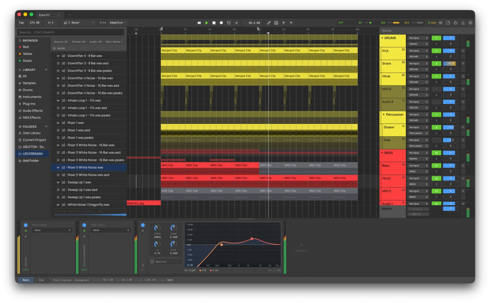

# Dream DAW

A desktop digital audio workstation: a real-time Rust audio engine, a React/TypeScript
interface, and out-of-process hosting for VST2, VST3 and Audio Unit plugins.



| Arrangement & clip editor | Mixer & effects |
| --- | --- |
|  |  |

## Repository layout

| Path | Contents |
| --- | --- |
| `core/dream_models` | Project, clip, MIDI and delta data model — the canonical state schema |
| `core/dream_mutators` | Mutations applied to the project state |
| `core/dream_orchestrator` | Command and query layer over the project state |
| `core/dream_graph` | Audio graph: DAG, routing, delay compensation, RCU-swapped render state |
| `core/dream_dsp` | Biquad/SVF/ZDF filters, resampling, dither, device chain and processors |
| `core/dream_engine` | Real-time engine: driver, render callback, instruments, sampler, recording, offline bounce |
| `core/dream_mixer` | Channel strips, buses, gain, pan, solo and metering |
| `core/dream_transport` | Playhead, loop region and transport state |
| `core/dream_clip_engine` | Clip scheduling, disk streaming and sample pools |
| `core/dream_automation` | Automation lanes, curves and modes |
| `core/dream_plugins` | Plugin subsystem: scanning, descriptors and sandboxed VST2/VST3/AU hosts |
| `core/dream_io` | WAV/AIFF/MP3 I/O, peak cache, project persistence |
| `core/dream_importers` | Ableton project import and stem separation helpers |
| `core/dream_ipc` | Audio-side IPC: metering and preallocated queues |
| `core/dream_renderer` | GPU timeline and viewport rendering |
| `apps/plugin_host_daemon` | Out-of-process plugin host daemon |
| `frontend/ui_app` | React 19 + TypeScript + Vite (Tauri) interface |
| `frontend/shared_bindings` | TypeScript bindings generated from Rust types via `ts-rs` |
| `scripts/` | Project gates: SSOT bindings, IPC contract, audio chain routing, architecture budget, audits |

## Requirements

- Rust `1.93.1` with `rustfmt` and `clippy` (pinned in `rust-toolchain.toml`)
- Node `22` and pnpm `10` for the interface

## Build and test

```bash
# Audio engine and workspace crates
cargo fmt --check
cargo test --workspace --release

# Interface
pnpm -C frontend/ui_app install --frozen-lockfile
pnpm -C frontend/ui_app run sync:bindings   # regenerate Rust -> TS bindings
pnpm -C frontend/ui_app run build
```

`scripts/` holds the project's own gates — SSOT bindings, delta IPC contract, audio chain
routing, architecture budget and the full project audit. `.github/workflows/ci.yml` is the
canonical list of everything that runs on every push and pull request.

## Architecture principles

- **Single source of truth.** Rust types are authoritative; TypeScript bindings are
  generated from them (`pnpm run sync:bindings`), never hand-written.
- **Real-time discipline.** Realtime-critical signalling goes through preallocated queues
  (`core/dream_ipc/src/prealloc_queue.rs`), and graph state is published with RCU swaps
  (`core/dream_graph/src/rcu.rs`).
- **Isolation.** Plugins run out of process, so a misbehaving plugin cannot take the
  engine down.

## License

Released under the [MIT License](LICENSE).

Third-party content bundled or shown with the application — audio samples, presets,
fonts and plugin binaries — is **not** covered by this license and keeps its own terms.
