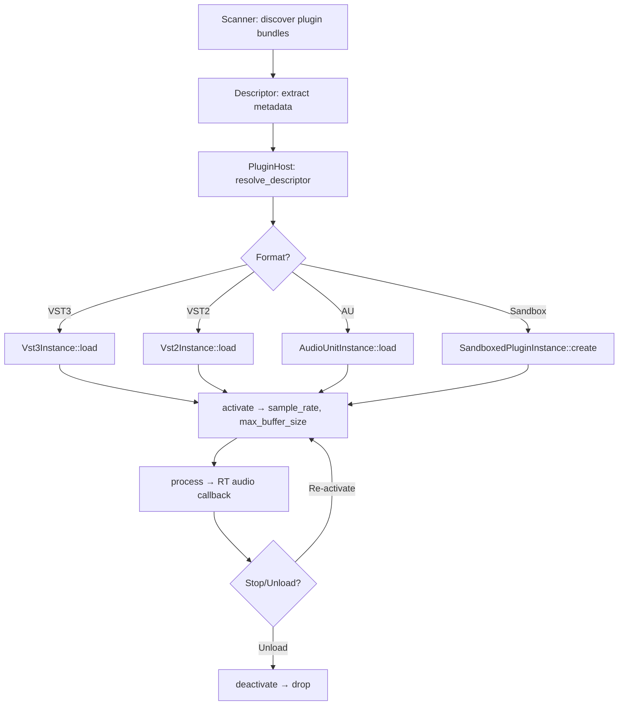

# Dream DAW — VST & Plugins Architecture Manifest

> Enterprise-grade documentation of the complete plugin hosting system,
> effect chains, device routing, MIDI dispatch, state persistence,
> and editor lifecycle.

---

## 1. Supported Plugin Formats

| Format | Extension | Module | RT Process | State Save/Load | Editor |
|--------|-----------|--------|------------|-----------------|--------|
| **VST3** | `.vst3` | `dream_plugins::vst3_host` | COM `IAudioProcessor::process` | DDS1 combined format (component + controller) | NSWindow + IPlugView |
| **VST2** | `.vst` | `dream_plugins::vst2_host` | FFI `processReplacing` / legacy `process` | Chunk-based `setChunk`/`getChunk` | `effEditOpen`/`effEditClose` |
| **Audio Units** | `.component` | `dream_plugins::au_host` | `AudioUnitRender` | Not yet implemented | Cocoa View via `kAudioUnitProperty_CocoaUI` |
| **Sandbox** | Any (OOP) | `dream_plugins::sandbox_instance` | Shared memory IPC | Via daemon forwarding | Via daemon forwarding |
| **CLAP** | `.clap` | Redirected to VST3/VST2 | — | — | — |

---

## 2. Plugin Lifecycle



### 2.1 VST3 Load Sequence
1. `resolve_vst3_binary(bundle_path)` → dylib path
2. `libloading::Library::new(dylib_path)` → loaded shared library
3. `bundleEntry(bundle_ref)` (macOS) or `InitDll()` (Windows)
4. `GetPluginFactory()` → `IPluginFactory*`
5. `factory.createInstance(cid, IComponent)` → component
6. `component.initialize(host_application)` → host wiring
7. `component.queryInterface(IAudioProcessor)` → processor
8. Create or QI `IEditController` for parameter control
9. Wire `IConnectionPoint` (component ↔ controller)
10. `IComponentHandler` COM singleton → param edits, latency changes

### 2.2 VST3 Activation Sequence
1. `setBusArrangements(stereo, stereo)` — configure I/O layout
2. Activate audio input/output buses (bus 0 = main)
3. Activate event (MIDI) input bus if present
4. Dynamically toggle sidechain bus (bus 1) based on signal presence
5. `setupProcessing(ProcessSetup)` — sample rate, block size, mode
6. `setActive(1)` → `setProcessing(1)`

### 2.3 VST3 Teardown Sequence (in `drop()`)
1. `close_editor()` — tear down NSWindow/IPlugView
2. Disconnect `IConnectionPoint` wiring (BEFORE releasing interfaces!)
3. `setProcessing(0)` on IAudioProcessor
4. Release IAudioProcessor (only if separate COM object from IComponent)
5. `setActive(0)` → `terminate()` → `release()` on IComponent
6. Terminate/release IEditController (only if separate from IComponent)
7. Release IPluginFactory
8. `bundleExit()` / `ExitDll()`
9. **macOS**: `std::mem::forget(library)` — intentional leak to prevent Obj-C crash

---

## 3. Real-Time Audio Processing Pipeline

### 3.1 Per-Track FX Chain (inside `graph_renderer.render()` closure)

```
┌────────────────────────────────────────────────────────────┐
│  For each track node in topological order:                 │
│                                                            │
│  1. Copy source buffer → graph left/right                  │
│     (or MIX for group/bus tracks with routed inputs)       │
│                                                            │
│  2. Process insert FX chain (in slot order):               │
│     ┌─ If internal slot → DeviceChain.process_slot()       │
│     └─ If external slot:                                   │
│        a. Apply automation to plugin params                │
│        b. Copy graph buffers → external scratch            │
│        c. Resolve sidechain source (if configured)         │
│        d. For instruments: schedule MIDI events             │
│        e. host.process_with_sidechain()                    │
│        f. On success: copy external scratch → graph        │
│        g. On error: passthrough (leave graph unchanged)    │
│                                                            │
│  3. Process mixer strip (volume, pan, mute/solo gate)      │
│  4. Apply sample-accurate mixer automation                 │
│  5. Compute per-track metering (RMS + peak decay)          │
│  6. Write back to slot buffers for downstream sidechain    │
└────────────────────────────────────────────────────────────┘
```

### 3.2 Master FX Chain (`process_master_runtime_fx_and_gain()`)
- Resolves master runtime slots from external FX snapshot
- External plugins: same process_with_sidechain flow
- Internal: `DeviceChain.process_stereo()`  
- Applies master gain with exponential smoothing (~5ms time constant)
- Fallback: if no external FX active, uses internal master device chain

### 3.3 Post-Processing
1. `interleave_graph_output()` → stereo/mono interleaving
2. `render_test_tone_if_needed()` → development only
3. `mix_preview_audio()` → sample preview overlay
4. `finalize_output_and_publish()` → soft clip, metering, spectrum

---

## 4. MIDI Dispatch Architecture

```
UI Thread:                     RT Audio Thread:
┌──────────────┐              ┌─────────────────────────────┐
│ Keyboard/Pad │              │ 1. Drain vst3_rt_midi_queue │
│ MIDI events  │──(command)──>│ 2. MidiScheduler clips      │
│              │              │ 3. Apply MIDI FX:            │
│              │              │    - Pitch transpose         │
│              │              │    - Scale quantize          │
│              │              │    - Random pitch            │
│              │              │    - Velocity gain/offset    │
│              │              │ 4. Note tracker (on/off)     │
│              │              │ 5. Sort by sample_offset     │
│              │              │ 6. Pass to plugin.process()  │
└──────────────┘              └─────────────────────────────┘
```

### 4.1 Note Tracking
- Per-track `Vst3NoteTracker` with active note tracking
- `flush_all()` on stop/seek → injects note-off for all held notes
- Per-track flush flags (not global — prevents killing notes on unrelated tracks)
- Duplicate note-on handling: inject note-off 1 sample before re-trigger

### 4.2 Transport Context Per Plugin Role
- **Effects**: `is_playing` follows DAW transport exactly
- **Instruments**: `is_playing = daw_playing || has_pending_midi || has_active_notes`
  - This ensures instruments process release tails after DAW stops

---

## 5. State Persistence

### 5.1 VST3 DDS1 Combined Format
```
[4 bytes]  Magic: "DDS1"
[4 bytes]  Component data length (LE u32)
[N bytes]  IComponent state (DSP parameters)
[M bytes]  IEditController state (preset name, UI state)
```

### 5.2 Save Flow
1. `IComponent::getState()` → component bytes
2. `IEditController::getState()` → controller bytes
3. Combine into DDS1 format
4. Base64-encode → store in `PluginSlot.external_state_blob`

### 5.3 Load Flow
1. Parse DDS1 (or fallback: raw component data for old format)
2. `IComponent::setState(component_data)` 
3. `IEditController::setComponentState(component_data)` — sync editor
4. `IEditController::setState(controller_data)` — restore UI state
5. **Reactivation sequence**: 
   `setProcessing(0) → setActive(0) → setActive(1) → setupProcessing() → setProcessing(1)`

### 5.4 VST2 State: chunk-based `setChunk`/`getChunk` (isPreset=0 for full bank)

---

## 6. Plugin Registry & Thread Safety

### 6.1 Lock-Free Plugin Registry
- `SharedPluginRegistry = ArcSwap<HashMap<Uuid, PluginInstanceArc>>`
- UI thread publishes periodic snapshots via `publish_registry()`
- RT thread loads with `plugin_registry.load()` — nanosecond lock-free access
- Per-plugin `Mutex<Box<dyn PluginInstance>>` with `try_lock()` on RT thread
  - If lock contention: skip plugin (passthrough) — never block

### 6.2 External FX Snapshot
- `SharedExternalFxSnapshot = ArcSwap<Vec<Vec<ExternalFxRuntimeSlot>>>`
- Shape: `[track_0_slots, track_1_slots, ..., master_slots]`
- Each slot: `{ instance_id, internal_slot_index, is_instrument, sidechain_track_index }`
- Rebuilt on every mutation (add/remove/reorder plugin)

---

## 7. Sidechain Routing

### 7.1 Per-Slot Sidechain Source
- Each `ExternalFxRuntimeSlot` can specify `sidechain_track_index`
- RT thread resolves source slot from `render_ctx.track_slots[]`
- Safe buffer borrowing via `split_at_mut` pattern (no aliasing)
- VST3: dynamic sidechain bus activation via `activateBus(1, input, active)`

### 7.2 Inter-Track Routing
- `SharedRoutingSnapshot`: per-track output destination
- DAG topology built from routing → topological sort execution order
- Group/bus tracks: `post_sum_processing_mask` = true → MIX source + routed

---

## 8. Device Chain (Internal FX)

### 8.1 Architecture
- `DeviceChain`: per-track / master, up to `MAX_DEVICE_SLOTS = 16`
- Each slot: `BuiltinEffectType` (EQ, Compressor, Saturator, etc.)
- All processing is in-place stereo, per-sample with RT-safe primitives

### 8.2 Per-Slot Processing
- `process_slot_with_sidechain()` — for slots that accept sidechain
- `process_stereo()` — full chain, all active slots sequentially
- Bypass: per-slot `is_bypassed` flag, slot is skipped entirely

---

## 9. Editor Lifecycle

### 9.1 VST3 Editor (macOS)
1. `IEditController::createView("editor")` → IPlugView
2. `isPlatformTypeSupported("NSView")` check
3. `getSize()` → determine window dimensions
4. Create `NSWindow` (titled, closable, miniaturizable)
5. Set `setWantsLayer:YES` on contentView (CoreAnimation compositing)
6. Create dedicated `plugin_host_view` NSView for embedding
7. `setFrame(IPlugFrame)` BEFORE `attached()` — mandatory for VSTGUI
8. `attached(plugin_host_view, "NSView")`
9. `onSize()` → trigger initial layout
10. Window delegate for close/resize notifications

### 9.2 AU Editor (macOS)
1. `has_cocoa_ui_property()` → check for Cocoa UI capability
2. `create_cocoa_view_for_unit()` → NSView from AudioUnit
3. Embed in NSWindow with `addSubview()`
4. `setReleasedWhenClosed(false)` → explicit Rust ownership

### 9.3 Editor Close
- VST3: `removed()` → `setFrame(null)` → release IPlugView → close/release NSWindow
- AU: `close_window()` → `release_obj(window)`
- Both: main-thread guard enforced

---

## 10. Plugin Scanner

### 10.1 Search Paths (macOS)
- VST2: `/Library/Audio/Plug-Ins/VST/`, `~/Library/.../VST/`
- VST3: `/Library/Audio/Plug-Ins/VST3/`, `~/Library/.../VST3/`
- AU: `/Library/Audio/Plug-Ins/Components/`, `~/Library/.../Components/`
- CLAP: `/Library/Audio/Plug-Ins/CLAP/`, `~/Library/.../CLAP/`
- Custom paths: user-configurable

### 10.2 Deduplication
- Priority: VST3 > CLAP > AudioUnit > VST2
- Case-insensitive name matching
- CLAP plugins redirected to VST3/VST2 runtime if available

---

## 11. Sandbox (Out-of-Process)

### 11.1 Architecture
- Separate daemon process per sandboxed plugin
- Communication: shared memory ring buffer (lock-free)
- IPC: `mpsc::Sender<PluginHostControlMessage>` for control messages
- Crash recovery: bypass ramp (64 samples) after daemon restart

### 11.2 Process Flow
1. Write input samples to shared memory
2. Write MIDI events (first 4 inline, overflow via IPC channel)
3. Advance sequence counter (atomic)
4. Read daemon output from shared memory
5. If daemon hasn't written: passthrough (silence-safe)

---

## 12. Automation

### 12.1 External Plugin Automation
- `apply_external_plugin_param_automation_block()` before each process call
- Reads automation lanes from `AutomationSnapshot`
- Sets pending parameter values on the plugin instance
- Parameters delivered via VST3 `IParameterChanges` in ProcessData

### 12.2 Internal Plugin Automation
- Sample-accurate mixer automation (volume, pan)
- Applied post-strip via `apply_track_mixer_automation_sample_accurate()`

---

## 13. RT Safety Guarantees

| Guarantee | Mechanism |
|-----------|-----------|
| Zero allocations | Pre-allocated scratch buffers, `Vec::with_capacity()` at init |
| Zero locks | `ArcSwap::load()`, `try_lock()` with skip-on-contention |
| Zero I/O | No `log::`, no file I/O, no network on RT thread |
| Zero panics | `catch_unwind` wrapper → emit silence on panic |
| Denormal protection | DAZ/FTZ set at callback start, restored at end |
| Bounded work | Adaptive command budget, max 512 commands per callback |
